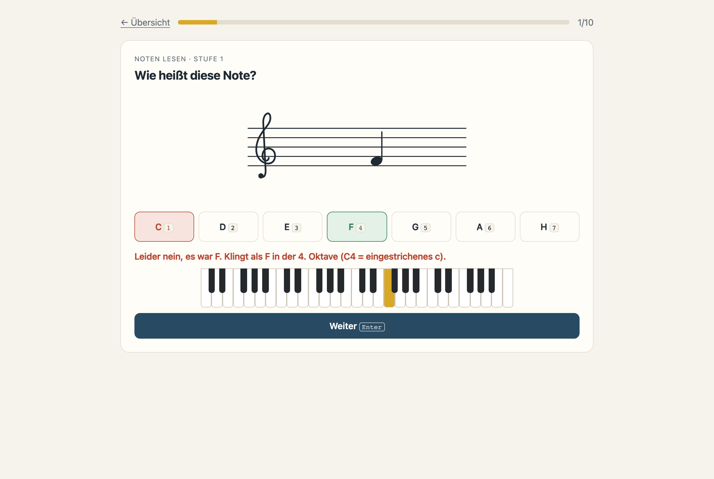

# Hörschule

Lern-App für Musiktheorie im Browser, in Runden zu je 10 Fragen. Vier Module mit je vier Stufen:

| Modul | Stufen |
|---|---|
| Noten lesen | Violinschlüssel → Hilfslinien → Bassschlüssel → beide mit Vorzeichen |
| Intervalle hören | Terz/Quinte/Oktave → + Sekunde, Quarte → + Sexten, abwärts → alle, auch gleichzeitig |
| Akkorde hören | Dur/Moll → + vermindert, übermäßig → + Septakkorde → + Umkehrungen |
| Quintenzirkel | bis 2 Vorzeichen → bis 4 → alle Dur-Tonarten → + Moll-Parallelen |



- **Adaptiv:** Was du oft falsch beantwortest, kommt häufiger dran. Die nächste Stufe schaltet sich frei, wenn du 10 der letzten 12 Fragen richtig hast.
- **Motivation:** Tagesziel (20 Antworten), Tagesserie, Punkte, Fortschrittsbalken je Modul
- **Klang:** Klaviertöne werden per Web Audio API synthetisiert, nach jeder Antwort zeigt die Klaviatur die gespielten Töne
- Deutsche Notennamen (H, B, Fis, Es …), Notensystem als SVG ohne Musikschrift
- Fortschritt bleibt im Browser (`localStorage`), Tastatur: `1`–`9` antworten, `Enter` weiter, `R` nochmal hören, `Esc` zur Übersicht

## Starten

Kein Build, keine Abhängigkeiten. Wegen der ES-Module nicht per `file://` öffnen:

```bash
python3 -m http.server 8000
```

## Tests

```bash
node --test
```

Prüft Notennamen und MIDI-Werte, dass jede generierte Frage aller Stufen genau eine richtige Antwort hat (über 3000 Fragen), dass Intervall-/Akkord-/Notenfragen zum gespielten Klang passen, Stufenaufstieg, Tagesserie, adaptive Auswahl und robustes Laden alter Spielstände.

## Lizenz

[MIT](LICENSE)
