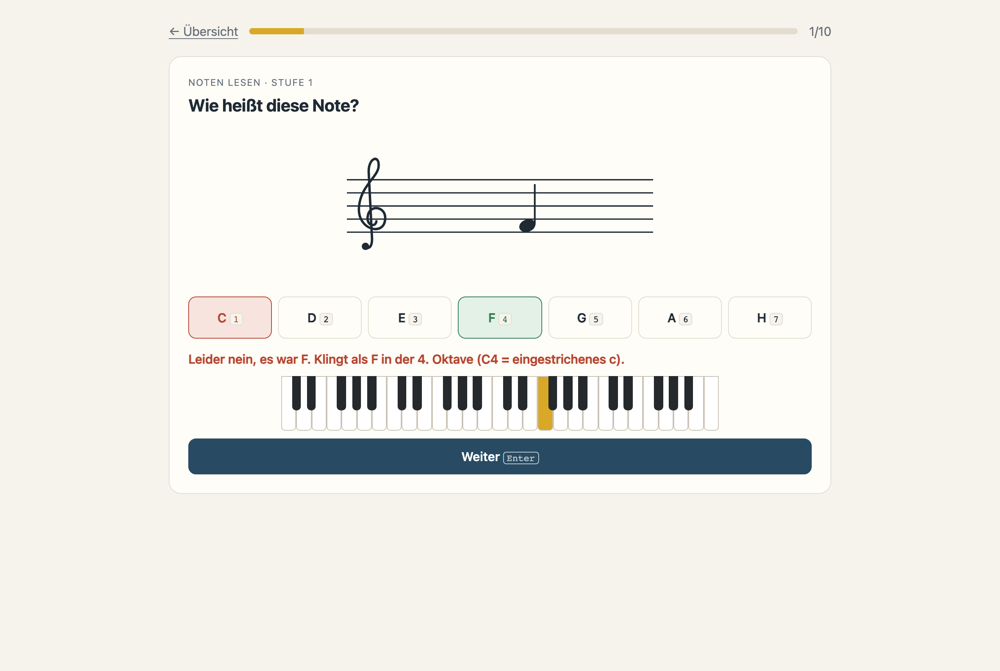

# Hörschule

[Deutsche Fassung](README.de.md)

**Ear training and music theory in the browser.** Rounds of 10 questions across four modules,
each with four levels. No build step, no dependencies, no audio files.



**Live demo:** <https://dark-player-jake.github.io/hoerschule/>

> [!NOTE]
> The app is in German and uses German note names (H, B, Fis, Es …). An English UI with
> international note names would be a welcome contribution.

## Modules

| Module | Levels |
|---|---|
| Reading notes | Treble clef → ledger lines → bass clef → both clefs with accidentals |
| Hearing intervals | 3rd/5th/octave → + 2nd, 4th → + 6ths, descending → all, also harmonic |
| Hearing chords | Major/minor → + diminished, augmented → + 7th chords → + inversions |
| Circle of fifths | Up to 2 accidentals → up to 4 → all major keys → + relative minors |

## Features

- **Adaptive:** what you often get wrong comes up more often. The next level unlocks when you
  answer 10 of the last 12 questions correctly.
- **Motivation:** daily goal (20 answers), daily streak, points, progress bar per module.
- **Sound:** piano tones are synthesized with the Web Audio API. After each answer a keyboard shows
  the notes that were played.
- Staff drawn as SVG, no music font needed.
- Progress stays in your browser (`localStorage`).
- Keys: `1`–`9` answer, `Enter` next, `R` play again, `Esc` back to the overview.

## Quick start

The app uses ES modules, so it has to be served over HTTP (opening `index.html` via `file://`
does not work):

```bash
git clone https://github.com/Dark-Player-jake/hoerschule.git
cd hoerschule
python3 -m http.server 8000
```

Then open <http://localhost:8000>.

## Privacy

Everything runs locally in your browser. No account, no tracking, no external requests.

## Development

```bash
node --test
```

The tests check note names and MIDI values, that every generated question on every level has
exactly one correct answer (over 3,000 questions), that interval, chord and note questions match
the sound that is played, level-ups, the daily streak, adaptive selection and loading of old
save data.

## Contributing

Issues and pull requests are welcome. Please run `node --test` before you open a pull request and
keep the project free of dependencies and external resources.

## License

[MIT](LICENSE)
